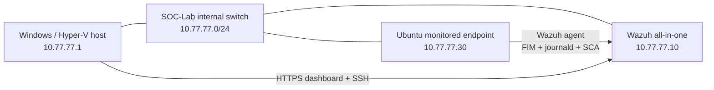

# SOC Home Lab — Wazuh SIEM, Detection Engineering & Incident Response

**Hands-on cybersecurity portfolio project** | Windows Hyper-V · Ubuntu Server 24.04.5 LTS · Wazuh 4.14.9 · Linux security monitoring

This lab demonstrates how I deployed a small security monitoring environment, investigated generated alerts, wrote and tested custom Wazuh detection rules, hardened an Ubuntu endpoint against CIS benchmark checks and carried out two documented incident-response exercises.

> **Scope:** All attack simulations and configuration changes were authorized activities in an isolated-purpose home lab. No real-world compromise or malicious actor is claimed. Work is ongoing.

## Highlights — verified in the lab

| Workstream | Verified result | Details |
| --- | --- | --- |
| SIEM deployment | Wazuh manager, indexer, dashboard, Filebeat and Ubuntu agent operating | [Architecture](architecture/README.md) |
| Endpoint monitoring | Real-time file creation, modification and deletion alerts; SSH and `sudo` journal monitoring | [Detections](detection-rules/README.md) |
| Authentication investigation | Repeated test SSH failures detected by Wazuh's built-in brute-force rule `5763` | [Architecture](architecture/README.md) |
| Custom detection 1 | **Rule 100100**: Level 10 sensitive-file change; positive and negative live tests passed | [XML](detection-rules/soc_lab_fim_rules.xml) |
| Custom detection 2 | **Rule 100101**: Level 8 privileged command referencing `/etc/shadow`; positive and negative tests passed | [XML](detection-rules/soc_lab_sudo_rules.xml) |
| SSH hardening | **20/20 passing SSH-related** CIS Ubuntu 24.04 checks (not the overall CIS score) | [Hardening notes](security-hardening/README.md) |
| Incident response — IR-001 | **IR-001:** simulated configuration tampering, correlated `sudo` activity and hash-verified recovery | [IR-001](incident-reports/IR-001-configuration-tampering.md) |
| Multi-alert investigation — IR-002 | **IR-002:** correlated Level 8 and Level 10 alerts 8.7 seconds apart, cross-checked against `sudo` journal events, and verified recovery | [IR-002](incident-reports/IR-002-correlated-privileged-activity.md) |
| Browser TLS | Dashboard HTTPS certificate corrected for lab IP, verified and trusted on Windows | [Hardening notes](security-hardening/README.md) |
| Wazuh server firewall hardening | Restricted SSH/dashboard to Windows and agent ports to monitored endpoint; verified API 55000 blocked from Windows and all services operational | [UFW assessment](security-hardening/wazuh-server-firewall.md) |
| Vulnerability management — VM-001 | Assessed 101 Critical and 862 High active-kernel inventory records; investigated two RDMA CVEs and verified reversible modprobe mitigation; fixes remain outstanding | [VM-001](vulnerability-management/VM-001-rdma-kernel-exposure.md) |
| Vulnerability management — VM-002 | Wazuh server kernel and security-update policy assessed; controlled `hello` install/removal and inventory deletion verified; historical 717-package indexing gap remains | [VM-002](vulnerability-management/VM-002-wazuh-server-vulnerability-assessment.md) |

## Architecture at a glance

The virtual machines also use the Hyper-V Default Switch for outbound connectivity. See the [full topology, telemetry flow and security boundaries](architecture/README.md).

## Detection engineering

### 100100 — Sensitive configuration modification

- Monitors a **specific** file, `/opt/soc-fim-test/critical-config.conf`, through Wazuh FIM.
- Extends built-in file-modification rule `550` and raises a **Level 10** alert.
- **Positive control:** change the sensitive test file → custom rule fires.
- **Negative control:** modify another file in the monitored directory → normal FIM event, no custom alert.
- Includes **MITRE ATT&CK T1565.001** as context for the simulated behavior.

### 100101 — Privileged authentication-file reference

- Inspects decoded `sudo` `command` fields for arguments referencing `/etc/shadow`.
- Works with parent rules `5402` and `5403`; the second was identified during log-testing and added before deployment.
- **Positive control:** `sudo stat /etc/shadow` → custom **Level 8** alert.
- **Negative control:** `sudo stat /etc/hosts` → ordinary `sudo` alert.
- The positive command reads **metadata only**, not password hashes.

See [rule source, implementation notes, test results and limitations](detection-rules/README.md).

## Incident response case study

**[IR-001 — Simulated configuration file tampering](incident-reports/IR-001-configuration-tampering.md)**

A harmless test configuration changed from `security_mode=normal` to `security_mode=disabled`. Wazuh rule `100100` generated a Level 10 alert. Investigation correlated the file-integrity event with Ubuntu `sudo` journal entries and identified the authorized test account and operation. The file was restored, then independently verified using the known-good SHA-256 hash and a recovery FIM alert.

The case documents **alert triage, timeline reconstruction, evidence correlation, a justified containment decision and recovery**. It is an **authorized simulation**, not an actual breach.

### IR-002 — Correlated privileged activity and configuration tampering

**[IR-002 — Multi-alert investigation and recovery](incident-reports/IR-002-correlated-privileged-activity.md)**

A controlled sequence produced a **Level 8** alert for a privileged command referencing `/etc/shadow`, followed **8.702 seconds** later by a **Level 10** FIM alert for changes to a harmless test configuration. The recovery alert independently verified that the file's SHA-256 returned to its known-good value. The incident report correlates the alerts with endpoint `sudo` journal entries identifying the account and command execution, records a justified **no-isolation** decision for this authorized simulation, and verifies recovery using the known-good SHA-256.

## Vulnerability management — VM-001

**[VM-001 — Linux kernel RDMA vulnerability assessment and temporary mitigation](vulnerability-management/VM-001-rdma-kernel-exposure.md)**

Wazuh identified **101 Critical** and **862 High** vulnerability inventory records against the **currently running** `6.8.0-147-generic` kernel. The assessment checked the package state against APT, examined the availability and runtime loading status of the `siw` and `rtrs-server` RDMA modules, and documented the two selected CVEs against official Ubuntu advisories. With no relevant kernel upgrade offered by configured repositories, the lab added a reversible `modprobe` restriction for these **unused modules**. Dry-run output and `lsmod` verified the control's expected behavior and that the targeted modules remain unloaded.

**This is an exposure-reduction measure, not a patch or proof that all reported vulnerabilities are resolved.**

## Wazuh server vulnerability assessment — VM-002

**[VM-002 — Wazuh server vulnerability, inventory synchronization and patch-policy investigation](vulnerability-management/VM-002-wazuh-server-vulnerability-assessment.md)**

The manager itself was added to vulnerability detection as agent `000`. Wazuh recorded **7,266 kernel-related vulnerability documents**, of which **2,982** pertained to its running `6.8.0-147-generic` image. Five sampled Critical CVEs were assessed against the VM's observed loaded modules, mounts, kernel configuration and services. Unused RDMA/Ceph/handshake components showed reduced apparent exposure, but kernel CVEs were **not** considered patched or ruled out.

An inventory-publishing limitation was independently reproduced: the manager's local source and management databases held **718 packages** after a harmless `hello` diagnostic install, but the package index held **only that one newly changed package**; its historical packages remained absent. **The diagnostic package's removal is now verified**: the indexer returned zero `hello` records, and both databases returned **717 packages / zero `hello`** after the 13:10 UTC Syscollector scan. The 717-package historical indexing gap remains open.

Ubuntu unattended security updating and both APT maintenance timers were enabled. The inspected configuration had no explicit automatic-reboot override; Ubuntu's documented default is off, though package updates may still restart affected services. See VM-002 for the full evidence trail, limitations and follow-up.

## Endpoint hardening

The lab endpoint uses key-based SSH access, disabled SSH passwords and root login, a restricted SSH allow-list, limited MAC algorithms and connection settings, an authorized-use banner and disabled forwarding. UFW restricts inbound SSH on the internal lab interface to the Windows host.

After testing, Wazuh displayed **20/20 passing SSH-specific CIS checks**. An earlier **overall** CIS scan was only **51%**, so the SSH subset result must not be mistaken for full system compliance. See [security-hardening notes](security-hardening/README.md).

## Wazuh server network exposure reduction

The Wazuh server originally had **UFW inactive** and management listeners including 22, 443, and 55000/TCP on network-facing addresses. UFW was enabled with an **inbound deny** policy and four host- and interface-limited exceptions for Windows SSH/dashboard access and Ubuntu endpoint agent transport/enrollment. The existing Wazuh agent, four Wazuh services, dashboard and Windows SSH connectivity were all verified afterwards. A Windows-origin negative-control connection to the API on **55000/TCP** failed as intended.

See the [Wazuh server UFW assessment](security-hardening/wazuh-server-firewall.md). The control reduces network exposure but does not remediate Wazuh software CVEs. Subsequent IPv6 inspection confirmed `IPV6=yes`, default `INPUT DROP`, no custom IPv6 inbound allow rules, and link-local-only interface addresses. Independent Default Switch reachability testing and external IPv6 connection tests remain open.

## Selected visual evidence

These are sanitized, cropped screenshots of **real controlled lab test results**, with no new events fabricated:

- [Wazuh CIS SSH assessment — 20/20 passing checks](evidence/ssh-cis-20-of-20.png)
- [Custom FIM rule 100100 — Level 10 positive detection](evidence/fim-custom-positive.png)
- [Custom sudo rule 100101 — Level 8 positive detection](evidence/sudo-custom-positive.png)
- [Custom sudo negative control — normal Level 3 event](evidence/sudo-custom-negative.png)
- [IR-001 recovery alert and restored hash](evidence/ir001-recovery.png)
- [IR-001 terminal verification of known-good value](evidence/ir001-terminal-hash.png)

See the [evidence gallery and context notes](evidence/README.md) for all six images.

## Repository guide

| Folder | Contents |
| --- | --- |
| [`architecture/`](architecture/README.md) | Logical topology, host roles, network and monitoring flow |
| [`detection-rules/`](detection-rules/README.md) | Two custom XML rules, validation strategy and limitations |
| [`incident-reports/`](incident-reports/IR-001-configuration-tampering.md) | Incident reports [IR-001](incident-reports/IR-001-configuration-tampering.md) and [IR-002](incident-reports/IR-002-correlated-privileged-activity.md) |
| [`security-hardening/`](security-hardening/README.md) | SSH/CIS, TLS, and [Wazuh server UFW](security-hardening/wazuh-server-firewall.md) assessments |
| [`vulnerability-management/`](vulnerability-management/VM-001-rdma-kernel-exposure.md) | [VM-001](vulnerability-management/VM-001-rdma-kernel-exposure.md) endpoint RDMA mitigation and [VM-002](vulnerability-management/VM-002-wazuh-server-vulnerability-assessment.md) server inventory/CVE/patch-policy assessment |
| [`evidence/`](evidence/README.md) | Six sanitized screenshots and documentation of evidence limitations |
| [`.gitignore`](.gitignore) | Exclusion rules for common secrets, captures and virtual disks |

## Safety and limitations

- All experiments were performed on personally controlled VMs and **test files**, not production infrastructure.
- Rule matches raise investigative signals, not proof of malicious intent. The custom detections have **limited** scope and require further tuning before production use.
- No SSH keys, CA private keys, passwords, tokens or VM disk images are included in the repository.
- Reviewed, cropped screenshots are included in the [evidence gallery](evidence/README.md).
- Wazuh's CIS score and vulnerability counts are assessment outputs, not a substitute for manual risk assessment or evidence of exploitable compromise.

## Planned next steps

- [x] Build the Hyper-V lab and integrate Wazuh agent telemetry.
- [x] Reproduce and investigate SSH authentication failures and file-integrity changes.
- [x] Create **two** custom detections with positive and negative controls.
- [x] Verify all **20 SSH-related** CIS controls in the displayed subset.
- [x] Complete a documented configuration-tampering incident response exercise.
- [x] Add reviewed, sanitized screenshots of detections, SSH controls and incident recovery.
- [x] Complete IR-002 multi-alert correlation, command-level `sudo` log corroboration, and hash-verified recovery.
- [x] Document incident-specific IR-002 `sudo` log evidence in the incident report.
- [ ] Add selected sanitized IR-002 screenshots to the evidence gallery.
- [ ] Export an additional standalone network diagram.
- [x] Investigate two selected RDMA CVEs, validate the current kernel and document VM-001 exposure mitigation.
- [ ] Reassess VM-001 when relevant Ubuntu security patches become available and attach sanitized screenshots.
- [x] Restrict Wazuh server exposure using UFW and verify management, agent, dashboard and API negative-control behavior.
- [x] Verify server IPv6 UFW policy, empty IPv6 user-allow chain, and link-local address scope.
- [x] Assess Wazuh server kernel-CVE exposure, unattended-update policy, and investigate local-to-indexer package mismatch (VM-002).
- [x] Verify `hello` removal reaches Wazuh inventories after the next scheduled package scan (index 0; both local databases 717 / `hello`=0).
- [ ] Resolve/backfill missing manager historical package index records when a safe supported method is established.
- [ ] Independently test Default Switch and IPv6 management-port reachability.
- [ ] Reassess overall CIS controls, record accepted risks and publish portfolio-ready evidence.

---

**Project status:** In progress. The linked rules and report reflect completed exercises; planned items are clearly labeled rather than presented as finished.
