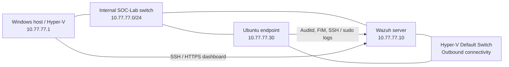

# SOC Home Lab — Wazuh detection engineering and incident response

**Personal cybersecurity project · v1.0 completed October 2026 · Wazuh 4.14.9 · Ubuntu 24.04.5 · Windows Hyper-V**

I built this lab to practise the work behind a security alert: collecting useful logs, writing detections, checking whether they fire for the right reasons, and documenting what happened. Rather than relying on screenshots of a dashboard alone, I kept the rule definitions, test results, investigation notes and recovery evidence together.

The main exercises are complete. There are still separate follow-up items for vulnerability remediation and making the repository suitable for public release.

## The lab



The Wazuh VM runs the manager, indexer, dashboard and Filebeat. A separate Ubuntu VM runs the Wazuh agent and generates the test events. The two VMs also have a Hyper-V Default Switch connection for outbound traffic, so this is **not** a fully internet-isolated environment. See [architecture and network boundaries](architecture/README.md).

## Custom detections

I wrote seven Wazuh XML rules. Each was tested against observed lab events; the results below describe what the rules actually detect, not what an attacker necessarily intended.

| Rule | Level | Detection | Source / investigation |
| --- | ---: | --- | --- |
| `100100` | 10 | Modification of a designated test configuration file | [FIM rule](detection-rules/soc_lab_fim_rules.xml) · [IR-001](incident-reports/IR-001-configuration-tampering.md) |
| `100101` | 8 | A `sudo` command with an argument referencing `/etc/shadow` | [Sudo rule](detection-rules/soc_lab_sudo_rules.xml) · [IR-002](incident-reports/IR-002-correlated-privileged-activity.md) |
| `100102` | 5 | Execution of the watched `/usr/bin/id` discovery command | [Discovery rule](detection-rules/100102-soc-lab-exec.xml) |
| `100103` | 8 | Changes to monitored cron configuration paths | [Cron rule](detection-rules/100103-soc-lab-cron.xml) |
| `100104` | 10 | User discovery followed by a cron change, matching audit user ID within 120 seconds | [Correlation rule](detection-rules/100104-soc-lab-correlation.xml) · [DE-003](detection-rules/DE-003-user-discovery-cron-correlation.md) |
| `100105` | 8 | Writes to Linux account databases | [Identity rule](detection-rules/100105-soc-lab-identity.xml) · [DE-004](detection-rules/DE-004-linux-account-lifecycle.md) |
| `100106` | 9 | Writes under the monitored sudoers configuration paths | [Sudoers rule](detection-rules/100106-soc-lab-sudoers.xml) · [DE-005](detection-rules/DE-005-sudoers-configuration-monitoring.md) |

The full [detection catalog](detection-rules/README.md) includes how the rules work, their audit keys and the testing approach. Account-database and sudoers writes are **change signals**; they do not independently prove that a new privilege was granted or that activity was malicious.

## What I investigated

- **[DE-003 — Discovery followed by cron activity](detection-rules/DE-003-user-discovery-cron-correlation.md):** A controlled sequence generated a Level 10 multi-stage alert. In the negative control, an isolated cron write after the correlation window raised the cron alert without raising the correlation alert. The test file contained no scheduled task.
- **[DE-004 — Linux account lifecycle](detection-rules/DE-004-linux-account-lifecycle.md):** Creating and deleting a locked, non-login test account each produced eight Level 8 filesystem alerts. Read-only account lookups produced no new matching alerts. The test account and group were removed.
- **[DE-005 — Sudoers configuration monitoring](detection-rules/DE-005-sudoers-configuration-monitoring.md):** A comment-only, ignored file in `/etc/sudoers.d` produced one Level 9 alert on creation and another on deletion. Read-only checks produced zero new matching alerts, and `visudo -c` passed after cleanup.
- **[IR-001 — Configuration tampering](incident-reports/IR-001-configuration-tampering.md):** Investigated a Wazuh FIM alert, checked related `sudo` activity, restored the test file and confirmed its known-good SHA-256.
- **[IR-002 — Correlated privileged activity](incident-reports/IR-002-correlated-privileged-activity.md):** Reconstructed a sequence of Level 8 `sudo` and Level 10 FIM alerts, corroborated the commands in the Ubuntu journal and documented why isolating the endpoint would not have been appropriate for the authorized test.

For the auditd exercises, I saved the rules under `/etc/audit/rules.d/`. After a controlled endpoint reboot, **all ten lab watches** were present, `auditd` and the Wazuh agent were active, and the audit subsystem reported **zero lost records**. The [identity](detection-rules/70-soc-lab-identity.rules) and [sudoers](detection-rules/80-soc-lab-sudoers.rules) configuration files are included in the repository.

## Hardening and vulnerability triage

- **[SSH and CIS assessment](security-hardening/README.md):** Configured key-only SSH access, disabled root/password login, restricted inbound SSH with UFW and validated **20 of 20 SSH-filtered CIS checks**. This is not a claim of full CIS compliance; an earlier overall assessment showed **51%**.
- **[Wazuh server firewall](security-hardening/wazuh-server-firewall.md):** Limited management access and agent ports to known lab peers. Verified that the dashboard and agent remained operational and that the manager API was not reachable from the Windows host over the tested path.
- **[VM-001 — Kernel RDMA findings](vulnerability-management/VM-001-rdma-kernel-exposure.md):** Investigated selected Ubuntu kernel vulnerability records and added a reversible restriction for unused RDMA modules. This reduced exposure for the assessed paths; it **did not patch the kernel**.
- **[VM-002 — Wazuh server assessment](vulnerability-management/VM-002-wazuh-server-vulnerability-assessment.md):** Examined server vulnerability results, update policy and an inventory indexing discrepancy. A diagnostic package was removed and verified absent, but the older **717-package historical indexing gap remains unresolved**.

## Evidence and repository guide

The [evidence gallery](evidence/README.md) contains **14 cropped screenshots** from the controlled exercises, including positive detections, negative controls and recovery checks. Some later investigations have written evidence but not standalone screenshots in the repository; those gaps are identified in their reports.

| Directory | Contents |
| --- | --- |
| [`architecture/`](architecture/README.md) | Topology, components and telemetry flow |
| [`detection-rules/`](detection-rules/README.md) | Seven XML rules, auditd configurations and DE-003–005 reports |
| [`incident-reports/`](incident-reports/IR-001-configuration-tampering.md) | IR-001 and IR-002 |
| [`security-hardening/`](security-hardening/README.md) | SSH, CIS, HTTPS and firewall work |
| [`vulnerability-management/`](vulnerability-management/VM-001-rdma-kernel-exposure.md) | VM-001 and VM-002 |
| [`evidence/`](evidence/README.md) | Test screenshots and interpretation notes |
| [`portfolio/`](portfolio/RELEASE-REVIEW.md) | [Publication review](portfolio/RELEASE-REVIEW.md) and [CV entry](portfolio/CV-ENTRY.md) |

## Checking the repository

From a clone of this repository, run:

```bash
python3 scripts/check_repository.py
```

The [offline checker](scripts/check_repository.py) checks the seven rule files, ten archived auditd watches, relative Markdown links and the integrity of the archived PNG files. It uses only the Python standard library. It **does not** execute Wazuh rules or connect to the lab VMs; the live test results are documented in the linked reports.

## Limits and next steps

All security events were generated in an **authorized home lab**, not during a real intrusion. The custom rules have deliberately narrow coverage, and a positive alert is not proof of exploitation. Vulnerability findings need advisory-level validation; several mitigations and inventory issues remain open. The cases are intended to show how I tested and investigated them, not to imply production readiness.

**Project status:** v1.0 is complete as a hands-on portfolio exercise. The repository remains **private** while publication privacy checks are outstanding. The [release review](portfolio/RELEASE-REVIEW.md) records remaining technical items, Git-history disclosure risks and the approval steps for any future public release.
