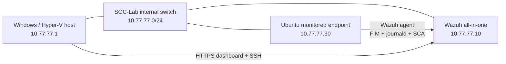

# SOC Home Lab — Wazuh SIEM, Detection Engineering & Incident Response

**Hands-on cybersecurity portfolio project** | Windows Hyper-V · Ubuntu Server 24.04.5 LTS · Wazuh 4.14.9 · Linux security monitoring

This lab demonstrates how I deployed a small security monitoring environment, investigated generated alerts, wrote and tested custom Wazuh detection rules, hardened an Ubuntu endpoint against CIS benchmark checks and carried out a documented incident-response exercise.

> **Scope:** All attack simulations and configuration changes were authorized activities in an isolated-purpose home lab. No real-world compromise or malicious actor is claimed. Work is ongoing.

## Highlights — verified in the lab

| Workstream | Verified result | Details |
| --- | --- | --- |
| SIEM deployment | Wazuh manager, indexer, dashboard, Filebeat and Ubuntu agent operating | [Architecture](architecture/README.md) |
| Endpoint monitoring | Real-time file creation, modification and deletion alerts; SSH and `sudo` journal monitoring | [Detections](detection-rules/README.md) |
| Authentication investigation | Repeated test SSH failures detected by Wazuh's built-in brute-force rule `5763` | [Architecture](architecture/README.md) |
| Custom detection 1 | **Rule 100100**: Level 10 sensitive-file change; positive and negative live tests passed | [XML](detection-rules/soc_lab_fim_rules.xml) |
| Custom detection 2 | **Rule 100101**: Level 8 privileged command referencing `/etc/shadow`; positive and negative tests passed | [XML](detection-rules/soc_lab_sudo_rules.xml) |
| SSH hardening | **20/20 passing SSH-related** CIS Ubuntu 24.04 checks (not the overall CIS score) | [Hardening notes](security-hardening/README.md) |
| Incident response | **IR-001:** detected simulated configuration tampering, correlated `sudo` activity, restored original content and verified the SHA-256 | [Incident report](incident-reports/IR-001-configuration-tampering.md) |
| Browser TLS | Dashboard HTTPS certificate corrected for lab IP, verified and trusted on Windows | [Hardening notes](security-hardening/README.md) |

## Architecture at a glance

The virtual machines also use the Hyper-V Default Switch for outbound connectivity. See the [full topology, telemetry flow and security boundaries](architecture/README.md).

## Detection engineering

### 100100 — Sensitive configuration modification

- Monitors a **specific** file, `/opt/soc-fim-test/critical-config.conf`, through Wazuh FIM.
- Extends built-in file-modification rule `550` and raises a **Level 10** alert.
- **Positive control:** change the sensitive test file → custom rule fires.
- **Negative control:** modify another file in the monitored directory → normal FIM event, no custom alert.
- Includes **MITRE ATT&CK T1565.001** as context for the simulated behavior.

### 100101 — Privileged authentication-file reference

- Inspects decoded `sudo` `command` fields for arguments referencing `/etc/shadow`.
- Works with parent rules `5402` and `5403`; the second was identified during log-testing and added before deployment.
- **Positive control:** `sudo stat /etc/shadow` → custom **Level 8** alert.
- **Negative control:** `sudo stat /etc/hosts` → ordinary `sudo` alert.
- The positive command reads **metadata only**, not password hashes.

See [rule source, implementation notes, test results and limitations](detection-rules/README.md).

## Incident response case study

**[IR-001 — Simulated configuration file tampering](incident-reports/IR-001-configuration-tampering.md)**

A harmless test configuration changed from `security_mode=normal` to `security_mode=disabled`. Wazuh rule `100100` generated a Level 10 alert. Investigation correlated the file-integrity event with Ubuntu `sudo` journal entries and identified the authorized test account and operation. The file was restored, then independently verified using the known-good SHA-256 hash and a recovery FIM alert.

The case documents **alert triage, timeline reconstruction, evidence correlation, a justified containment decision and recovery**. It is an **authorized simulation**, not an actual breach.

## Endpoint hardening

The lab endpoint uses key-based SSH access, disabled SSH passwords and root login, a restricted SSH allow-list, limited MAC algorithms and connection settings, an authorized-use banner and disabled forwarding. UFW restricts inbound SSH on the internal lab interface to the Windows host.

After testing, Wazuh displayed **20/20 passing SSH-specific CIS checks**. An earlier **overall** CIS scan was only **51%**, so the SSH subset result must not be mistaken for full system compliance. See [security-hardening notes](security-hardening/README.md).

## Repository guide

| Folder | Contents |
| --- | --- |
| [`architecture/`](architecture/README.md) | Logical topology, host roles, network and monitoring flow |
| [`detection-rules/`](detection-rules/README.md) | Two custom XML rules, validation strategy and limitations |
| [`incident-reports/`](incident-reports/IR-001-configuration-tampering.md) | Evidence-based incident report IR-001 |
| [`security-hardening/`](security-hardening/README.md) | SSH/CIS, firewall and TLS configuration evidence |
| [`evidence/`](evidence/README.md) | Screenshot plan and sanitization checklist; no screenshots committed yet |
| [`.gitignore`](.gitignore) | Exclusion rules for common secrets, captures and virtual disks |

## Safety and limitations

- All experiments were performed on personally controlled VMs and **test files**, not production infrastructure.
- Rule matches raise investigative signals, not proof of malicious intent. The custom detections have **limited** scope and require further tuning before production use.
- No SSH keys, CA private keys, passwords, tokens or VM disk images are included in the repository.
- Screenshots are not yet published; an [evidence index](evidence/README.md) records what should be reviewed and sanitized first.
- Wazuh's CIS score and vulnerability counts are assessment outputs, not a substitute for manual risk assessment or evidence of exploitable compromise.

## Planned next steps

- [x] Build the Hyper-V lab and integrate Wazuh agent telemetry.
- [x] Reproduce and investigate SSH authentication failures and file-integrity changes.
- [x] Create **two** custom detections with positive and negative controls.
- [x] Verify all **20 SSH-related** CIS controls in the displayed subset.
- [x] Complete a documented configuration-tampering incident response exercise.
- [ ] Add sanitized screenshots and an exportable network diagram.
- [ ] Run a multi-event incident investigation with a defensible response decision.
- [ ] Investigate and prioritize real vulnerability findings.
- [ ] Reassess overall CIS controls, record accepted risks and publish portfolio-ready evidence.

---

**Project status:** In progress. The linked rules and report reflect completed exercises; planned items are clearly labeled rather than presented as finished.
