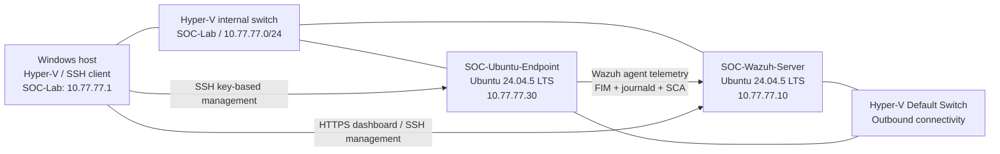

# SOC lab architecture

This project uses a **Windows Hyper-V host**, a Wazuh all-in-one server and an Ubuntu endpoint. The goal is to generate, detect and investigate controlled security events in a small, reproducible environment.

## Logical topology

## Inventory

| Component | Platform / role | Lab address |
| --- | --- | --- |
| Windows host | Hyper-V hypervisor; SSH administration and controlled test source | `10.77.77.1` |
| `SOC-Wazuh-Server` | Ubuntu 24.04.5 LTS; Wazuh manager, indexer, dashboard and Filebeat (4.14.9) | `10.77.77.10` |
| `SOC-Ubuntu-Endpoint` | Ubuntu 24.04.5 LTS; Wazuh agent (4.14.9); monitored workload | `10.77.77.30` |

Both VMs have a lab-facing interface on **SOC-Lab** and a separate interface on the **Hyper-V Default Switch** used for internet access during setup. Therefore, the lab is **not described as fully internet-isolated**. These addresses are private lab addresses, not public service endpoints.

## Monitoring pipeline

1. The Ubuntu endpoint generates events: file changes under `/opt/soc-fim-test/` and journal entries for SSH / `sudo` operations.
2. The Wazuh agent forwards relevant telemetry to the Wazuh manager.
3. Built-in and custom rules evaluate the events, including [custom FIM rule 100100](../detection-rules/soc_lab_fim_rules.xml) and [custom sudo rule 100101](../detection-rules/soc_lab_sudo_rules.xml).
4. The Wazuh dashboard enables alert triage, investigation and CIS security configuration assessment.

## Practical safeguards

- SSH management of the endpoint uses an Ed25519 key, limited authorized account access and no SSH password login.
- UFW limits inbound SSH on the endpoint's lab interface to the Windows host.
- HTTPS for the dashboard uses a private, lab-controlled certificate authority; **no private key or certificate authority material is included in this repository**.
- Security experiments use intentionally harmless test files; do not interpret them as proof of compromise.
- Machine images, sensitive logs and real credentials are excluded from version control.

## Reproduction notes

The documentation describes this specific working lab and its observed tests. It is **not** an unattended deployment recipe. Network adapter names, routing, SSH client paths and Wazuh installation commands must be adjusted if recreating the lab elsewhere.
