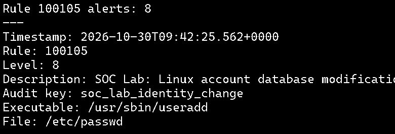
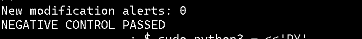

# DE-004 — Linux account lifecycle monitoring with auditd and Wazuh

**Status:** Controlled creation, negative-control and deletion tests **passed** on 30 October 2026. Persistent audit-rule configuration was **installed, compiled and successfully reloaded**; survival across an actual reboot remains **untested**.  
**Scope:** Authorized Linux endpoint account-change monitoring, not an actual compromise or privilege-escalation incident.  
**Environment:** Ubuntu endpoint `soc-endpoint` (Wazuh agent `001`), monitored by Wazuh 4.14.9 manager `soc-wazuh`.

## Objective and detection logic

Detect audited writes and attribute changes to Linux account databases while distinguishing filesystem modifications from benign read-only lookups.

Four **temporary live auditd watches** were verified by `auditctl -l`:

```text
-w /etc/passwd -p wa -k soc_lab_identity_change
-w /etc/shadow -p wa -k soc_lab_identity_change
-w /etc/group -p wa -k soc_lab_identity_change
-w /etc/gshadow -p wa -k soc_lab_identity_change
```

The manager's `/var/ossec/etc/lists/audit-keys` list was backed up and extended with `soc_lab_identity_change:write`. Custom rule [100105](100105-soc-lab-identity.xml) matches built-in parent `80780` and `audit.key=soc_lab_identity_change`, assigning **Level 8**. `wazuh-analysisd -t` succeeded; the manager and agent `001` were active.

**Scope limitation:** This rule reports a **database modification event**, **not** an account-creation verdict or an exact identity. Record attribution requires analyzing the executable, audit trail, account state and associated events. MITRE ATT&CK **T1098 (Account Manipulation)** provides investigative context, not evidence of malicious intent.

## Positive control — locked test account creation

The dedicated account `soclab_test` was checked as absent before testing. The endpoint executed:

```bash
sudo useradd -M -s /usr/sbin/nologin -p '!' soclab_test
```

The account had **no home directory created**, a **locked password**, and a `nologin` shell; no administrator group membership was assigned. Verification showed a local UID/GID of `1001`, password status `L`, and the nologin shell.

**Observed:** **Eight Level 8 rule 100105 alerts** from `/usr/sbin/useradd` clustered at **2026-10-30 09:42:25.562–09:42:25.583 UTC**. The displayed alert file fields included `/etc/passwd`, `/etc/shadow`, `/etc/group`, `/etc/gshadow`, and multiple `/etc/` parent records. Endpoint `ausearch -k soc_lab_identity_change -ts recent -i` corroborated `useradd` and the file operations.

Eight alerts reflect **multiple audited filesystem records arising from one account creation**, not eight created accounts.

## Negative control — read-only account lookups

The analyst saved existing `100105` alert identifiers as a baseline on the manager, then performed these **read-only** endpoint operations:

```bash
getent passwd soclab_test
id soclab_test
sudo passwd -S soclab_test
```

**Observed:** Comparing the manager's post-test `alerts.json` with the saved baseline returned **zero new Level 8 rule 100105 alerts** and printed **`NEGATIVE CONTROL PASSED`**. This is a bounded observation during this test, not proof that every read-like operation is undetected.

## Cleanup and detection of account deletion

The endpoint ran `sudo userdel soclab_test`. A subsequent check verified that **neither the account nor its matching group remained**: `TEST ACCOUNT AND GROUP REMOVED`.

**Observed:** **Eight Level 8 rule 100105 alerts** linked to `/usr/sbin/userdel`, between **2026-10-30 09:44:49.573 and 09:44:49.594 UTC**. File paths included the four watched account databases and `/etc/` directory records. The manager test printed **`CLEANUP DETECTION VERIFIED`**.

## What this test establishes

- The manager detected audited account-database modifications during the controlled creation and deletion sequences.
- Read-only checks did not generate additional rule `100105` alerts in the observed negative-control window.
- The temporary user account and group were removed following the test.
- A raw alert can represent a parent-directory event or one of several writes in a single `useradd`/`userdel` sequence; alerts must not be equated to individual accounts or incidents.

## Persistent auditd configuration and reload

The endpoint already had persistent watch files `50-soc-lab-exec.rules` and `60-soc-lab-cron.rules`, covering one execution watch and three cron watches. The four account watches originally existed **only in the active kernel ruleset**. Before changing persistence, the analyst backed up both `/etc/audit/rules.d/` and the compiled `/etc/audit/audit.rules`, plus saved an `auditctl -l` snapshot.

The account watches were placed in [`70-soc-lab-identity.rules`](70-soc-lab-identity.rules) under `/etc/audit/rules.d/` with root ownership and mode `640`. `augenrules --check` initially reported that rules had changed. Subsequently:

- `sudo augenrules --load` returned **exit code 0**.
- `sudo auditctl -l | grep 'soc_lab_'` displayed **all eight watches** (one discovery, three cron and four identity), and the independent count was **8**.
- `sudo augenrules --check` returned **No change**, consistent with an up-to-date compiled ruleset.
- `sudo auditctl -s` reported `enabled 1`, `lost 0`, `backlog 0`.

During loading, the tool also printed `No rules` and multiple audit status blocks, so the validation relies on the **post-load kernel rules and status**, not the intermediary string alone. **A VM reboot has not yet been performed to demonstrate boot-time restoration**.

## Archived visual evidence

**Creation:** A Level 8 rule `100105` event from `/usr/sbin/useradd` (part of the eight events documented above).



**Read-only negative control:** Zero new matching events against the saved baseline.



**Deletion:** The `userdel`-associated audit-event sequence and successful cleanup detection.


All images are cropped from actual screenshots supplied during this lab exercise; no alert text or values were fabricated.

## Limits and follow-up

- The watches were first configured with `auditctl -w` and then saved to the permanent `.rules` file. Reload verification succeeded, but **a post-reboot watch and agent-status check is still outstanding**.
- File watches and `audit.key` matching provide sensitive change telemetry, but they cannot alone distinguish authorized administration, account creation, permission changes, or malicious escalation. Production tuning would require alert deduplication, change approval context, target-account attribution, false-positive assessment and audit integrity protections.
- No `sudoers` or other privilege configuration was altered, and no actual privilege escalation was attempted.
- Full audit logs can contain names, arguments and private details; archive only reviewed/redacted test evidence, not raw `/etc/shadow` or credential material.
- Three cropped original terminal screenshots have been committed as [account creation](../evidence/de004-account-creation.png), [read-only negative control](../evidence/de004-readonly-negative.png), and [account deletion](../evidence/de004-account-deletion.png). These show portions of the manager's test output, **not** a full dashboard incident investigation.

See the [detection catalog](README.md) for all custom rules.
