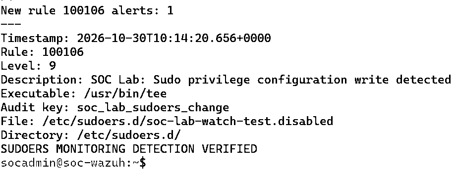
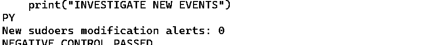
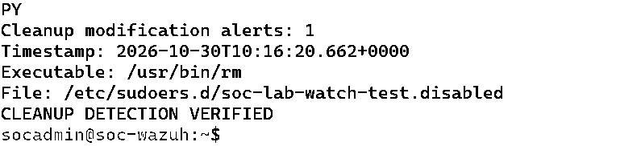

# DE-005 — Sudoers configuration monitoring

**Status:** Positive detection, read-only negative control, cleanup detection and sudo configuration validation **passed**, 30 October 2026 UTC. Auditd watches compiled, loaded, and **verified after a controlled endpoint reboot**.

**Environment:** Ubuntu 24.04.5 LTS monitored agent `soc-endpoint` (Wazuh `001`); Wazuh manager `soc-wazuh` 4.14.9. All actions were authorized and performed on the user's isolated home-lab environment.

## Objective

Detect write operations affecting sudo's main privilege policy file and its include directory, without granting an account new privileges or compromising administrator access. This is **privileged-configuration change monitoring**, not a demonstration of exploitation or actual privilege escalation.

## Setup

The analyst confirmed `/etc/sudoers` and `/etc/sudoers.d` existed, `/etc/sudoers.d` contained only its README file, and `sudo visudo -c` successfully parsed the configuration.

The endpoint's persistent auditd rules are archived in [`80-soc-lab-sudoers.rules`](80-soc-lab-sudoers.rules):

```text
-w /etc/sudoers -p wa -k soc_lab_sudoers_change
-w /etc/sudoers.d -p wa -k soc_lab_sudoers_change
```

The existing audit-rule folder was backed up first. `sudo augenrules --load` returned exit **0**; subsequent `auditctl -l` showed **ten** SOC lab watches in total (eight previously established plus two new sudoers watches).

On the manager, a backup of `/var/ossec/etc/lists/audit-keys` was made and the mapping `soc_lab_sudoers_change:write` was added. The Level 9 [custom Wazuh rule `100106`](100106-soc-lab-sudoers.xml) uses parent `80780` and exact matching of `audit.key=soc_lab_sudoers_change`. `wazuh-analysisd -t` completed successfully, manager restart returned `active`, and agent `001` was `Active`.

MITRE ATT&CK **T1548.003** (Sudo and Sudo Caching) is **analytical context**. The lab event does not prove exploitation or any change in effective privileges.

## Positive control — monitored directory write

To avoid changes to effective sudo policy, the analyst confirmed the target path was unused and created a **comment-only** file named `/etc/sudoers.d/soc-lab-watch-test.disabled`:

```bash
printf '%s\n' '# SOC Lab sudoers monitoring test - no privilege changes' | sudo tee /etc/sudoers.d/soc-lab-watch-test.disabled
```

The filename contains a dot and is ignored by standard sudo include-directory parsing; its contents define no privileges. The endpoint's `ausearch -k soc_lab_sudoers_change -ts recent -i` displayed a matching `/usr/bin/tee` audit event for the test path.

**Observed:** One new Wazuh **rule `100106` Level 9** alert relative to the saved baseline, timestamp **2026-10-30T10:14:20.656Z**, on agent `001`. Its `data.audit.exe` was `/usr/bin/tee`, `data.audit.key` was `soc_lab_sudoers_change`, `data.audit.file.name` was the test filename, and `data.audit.directory.name` was `/etc/sudoers.d/`.

## Negative control — read-only operations

After saving the existing `100106` alert identifiers to `/tmp/soclab-100106-negative-baseline.json` on the manager, the analyst executed `sudo cat`, `sudo stat` against the test file, and `sudo visudo -c` on the endpoint.

**Observed:** The manager query found **zero new `100106` alerts** compared with the baseline and printed **`NEGATIVE CONTROL PASSED`**. The sudo configuration parsed correctly during this test. This is a bounded test result, not proof that all read-only operations will always be silent.

## Cleanup — remove test file and confirm detection

The analyst ran:

```bash
sudo rm -- /etc/sudoers.d/soc-lab-watch-test.disabled
sudo test ! -e /etc/sudoers.d/soc-lab-watch-test.disabled && echo "TEST FILE REMOVED"
sudo visudo -c
```

**Observed:** The test file was absent and the remaining `/etc/sudoers` and `/etc/sudoers.d/README` both reported **parsed OK**. Wazuh subsequently recorded **one** new Level 9 `100106` alert for `/usr/bin/rm`, timestamp **2026-10-30T10:16:20.662Z**, with the same test target path. The script printed **`CLEANUP DETECTION VERIFIED`**.

## Archived visual evidence

All three images below are cropped, high-contrast versions of **original terminal screenshots** from this authorized exercise. They display the observed test outputs, not reconstructed or invented logs.

**Positive — one Level 9 alert** at 10:14:20.656 UTC:



**Negative — zero new modification alerts** during read-only checks:



**Cleanup — one deletion alert** at 10:16:20.662 UTC:



## Controlled reboot persistence validation

After confirming both sudoers watches were present in compiled `/etc/audit/audit.rules` and that `augenrules --check` reported **No change**, the analyst rebooted **only the monitored endpoint** at approximately **10:24:51 UTC, 30 October 2026**. The existing passphrase-protected ED25519 SSH key was used to reconnect. No SSH authentication or firewall hardening was relaxed.

**Post-reboot verification:**

| Check | Observed result |
| --- | --- |
| `systemctl is-active auditd wazuh-agent` | `active`, `active` |
| `auditctl -l` | All **10** SOC lab watches, including both sudoers watches |
| `auditctl -l | grep -c 'soc_lab_'` | `10` |
| `augenrules --check` | `No change` |
| `auditctl -s` | `enabled 1`, `lost 0`, `backlog 0` |
| `visudo -c` | `/etc/sudoers` and `/etc/sudoers.d/README` both **parsed OK** |
| Manager `agent_control -l` | Agent `001` (`soc-endpoint`) **Active** |

This is a verified, bounded **single-reboot persistence test**. The terminal screenshots were inspected in the lab conversation; the existing [gallery](../evidence/README.md) contains the prior positive, negative, and cleanup evidence, not a standalone post-reboot crop.

## Interpretation and limitations

- No new sudo-capable identity was created, and no effective sudo privileges were changed.
- A write or deletion within the watched directory is a **configuration-path activity signal**, **not proof** that effective policy changed or that an attacker escalated privileges.
- Neither the rule nor these tests show comprehensive coverage of all privilege escalation paths. Other mechanisms such as setuid binaries, PAM policy, or capabilities are outside scope.
- Wazuh alerting depends on auditd watches, log ingestion, compatible event decoding, parent rule `80780`, and the manager's audit-key mapping.
- Both sudoers watches survived **one controlled endpoint reboot** as part of ten active SOC lab watches. This does not prove resilience to every later OS update or auditd configuration change.
- No automatic response or containment was configured.
- Screenshots were supplied from real lab terminal tests; the write-up distinguishes observed outputs from interpretations. Reviewed excerpts are archived in the [evidence gallery](../evidence/README.md).

## Follow-up

Verify all ten watches after a future controlled reboot; optionally correlate policy-file writes with the identity behind a change, classify benign administrative updates, and tune alerts to avoid inferring privilege escalation from every directory write.
