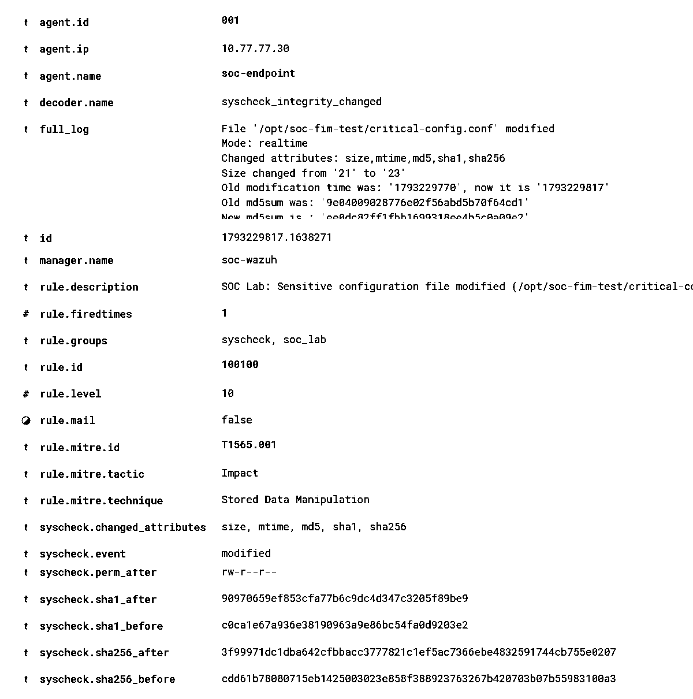
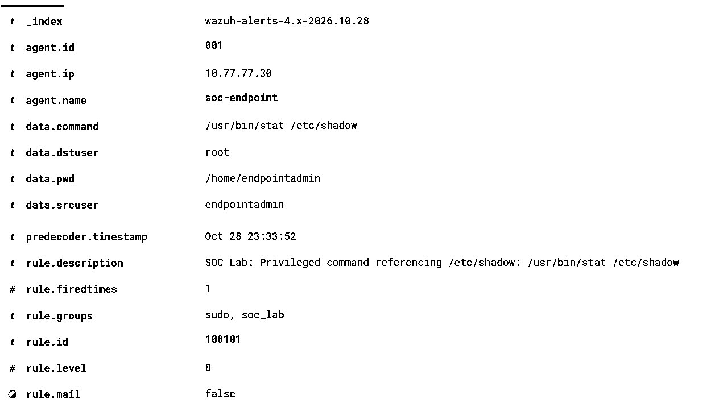
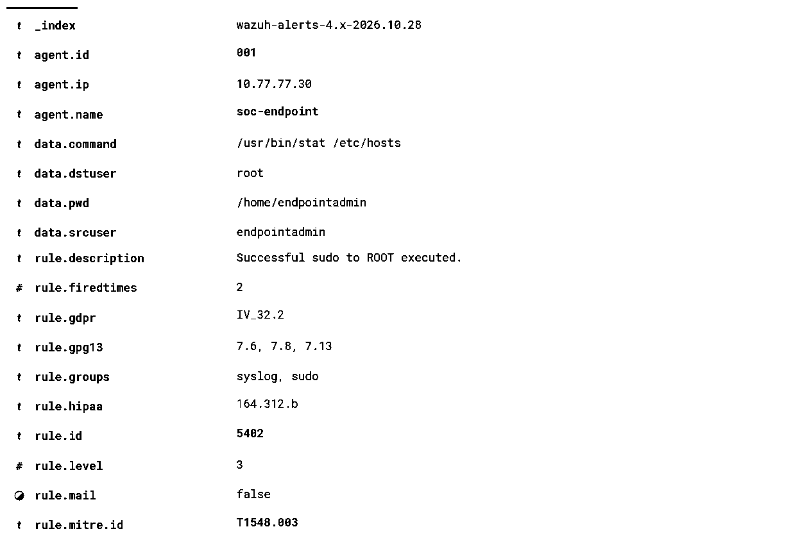

# Custom Wazuh detection rules

These rules were developed and tested in the SOC home lab using Wazuh **4.14.9**, Ubuntu **24.04.5 LTS**, and monitored agent `soc-endpoint` (`001`).

The repository contains **only the custom rules authored for the lab**, not Wazuh's built-in rules, any credentials or certificate material.

## Detection catalog

| Rule | Severity | Input | Trigger | Validation |
| --- | --- | --- | --- | --- |
| [`100100`](soc_lab_fim_rules.xml) | 10 | Wazuh FIM (`syscheck`), parent `550` | Real-time *modification* of `/opt/soc-fim-test/critical-config.conf` | Positive + negative tests, live alert |
| [`100101`](soc_lab_sudo_rules.xml) | 8 | Decoded `sudo` logs, parent `5402` or `5403` | Privileged command with whitespace-delimited `/etc/shadow` argument | Positive + negative `wazuh-logtest` tests, live alert |
| [`100102`](100102-soc-lab-exec.xml) | 5 | Auditd `/usr/bin/id` execution, parent `80789` | Audit key `soc_lab_exec_test` plus exact executable | Live discovery alerts observed |
| [`100103`](100103-soc-lab-cron.xml) | 8 | Auditd cron write watch, parent `80780` | Audit key `soc_lab_cron_change` | Live cron modification alert, including negative control |
| [`100104`](100104-soc-lab-correlation.xml) | 10 | Prior `100102` and current `100103`, matching `audit.auid` within 120 s | User discovery followed by cron change | **Positive live correlation + negative control passed** |

### Rule 100100 — Sensitive configuration change

- **Purpose:** Elevate a targeted FIM modification from the normal built-in file-integrity alert to a specific Level 10 investigation signal.
- **MITRE ATT&CK context:** T1565.001 (Stored Data Manipulation), as a classification of the simulated change, **not a claim of an actual attacker**.
- **Positive:** Write `security_mode=disabled` to the existing lab file → rule `100100` generated a live alert.
- **Negative:** Create and modify `control-config.conf` in the same directory → ordinary FIM events appeared; **no** `100100` alert for that path.
- **Recovery:** Restore `security_mode=normal` → the same rule generated another expected alert. Detection alone does not determine if a modification is malicious or authorized.

### Rule 100101 — Privileged command referencing authentication file

- **Purpose:** Surface elevated administrative commands referencing the sensitive `/etc/shadow` path for investigation.
- **Why two parent IDs:** `wazuh-logtest` selected rule `5403` (first observed `sudo` execution) even when normal live events could match `5402`. The rule was corrected to `<if_sid>5402,5403</if_sid>` to handle both.
- **Positive:** `sudo /usr/bin/stat /etc/shadow > /dev/null` → live `100101`, Level 8.
- **Negative:** `sudo /usr/bin/stat /etc/hosts > /dev/null` → normal `5402`, Level 3.
- **Interpretation:** `stat` checks file metadata; it does **not** demonstrate password hash extraction, exfiltration or compromise.

### Rules 100102–100104 — Auditd discovery, cron and multi-stage correlation

- **100102 (Level 5):** Recognizes `/usr/bin/id` executions tagged `soc_lab_exec_test` by the endpoint's auditd watch.
- **100103 (Level 8):** Recognizes writes or attribute changes to watched cron paths tagged `soc_lab_cron_change`.
- **100104 (Level 10):** Uses `frequency="2"`, `timeframe="120"`, `if_matched_sid=100102`, `if_sid=100103`, and matching `audit.auid` to associate the discovery and cron activity.

**Live positive result (2026-10-30):** The manager indexed rule `100104` at **09:04:41.425 UTC** on agent `001`, with `/usr/bin/tee` writing a comment-only `.disabled` file under `/etc/cron.d`. The audit login ID was `1000`; this was an authorized test and did **not** install an active cron task.

**Live negative result (2026-10-30):** After 326 seconds since the latest discovery event, an isolated cron file creation generated **one `100103`** alert (**09:11:14.454 UTC**) and **zero `100104`** alerts on that test target. The check returned `NEGATIVE CONTROL PASSED`. Both temporary test files were removed and their absence verified.

See the [DE-003 correlation case study](DE-003-user-discovery-cron-correlation.md) for the sequence, relevant auditd watch configuration, timestamps, exact paths, assumptions, and limitations. The new XML files are transcriptions from manager console output. Sanitized DE-003 screenshots are still pending repository upload.

## Installation on a Wazuh manager

For an appropriately isolated practice environment, copy the XML files to `/var/ossec/etc/rules/`, assign the manager's `wazuh:wazuh` ownership and restrictive permissions, validate, then restart the manager to load changes:

```bash
# After copying the repository XML into /var/ossec/etc/rules/:
sudo chown wazuh:wazuh /var/ossec/etc/rules/soc_lab_*_rules.xml /var/ossec/etc/rules/10010[234]-soc-lab-*.xml
sudo chmod 640 /var/ossec/etc/rules/soc_lab_*_rules.xml /var/ossec/etc/rules/10010[234]-soc-lab-*.xml
sudo /var/ossec/bin/wazuh-analysisd -t
# Restart only after the configuration test passes:
sudo systemctl restart wazuh-manager
sudo systemctl is-active wazuh-manager
```

The rule files expect compatible parent rule IDs, decoded event fields and endpoint auditd watches. Confirm these against the installed Wazuh ruleset before reuse in other versions. The three numbered filenames are the paths observed on the manager; their exact names do not control rule execution.

## Testing approach

1. Validate ruleset syntax with `wazuh-analysisd -t`.
2. Test positive and negative log samples with `wazuh-logtest`.
3. Generate controlled endpoint activity.
4. Confirm the indexed alert's `rule.id`, `rule.level`, `agent.name`, decoded fields and file path or command.
5. Verify **negative controls**, not just positive detection.
6. Investigate benign triggers and potential false positives before enabling automated response.

## Visual validation evidence

The screenshots below are **cropped, high-contrast excerpts** of the lab's original Wazuh event views, with unrelated interface regions omitted.

**FIM positive control — rule 100100, Level 10**



**Sudo positive control — rule 100101, Level 8**



**Sudo negative control — ordinary rule 5402, Level 3**



The FIM negative-control result (two normal events and zero matches for rule 100100 on the unrelated control file) was observed during the test, but no separate screenshot of the zero-result query was captured.

**DE-003 evidence status:** The rule 100104 indexed dashboard event and the console outputs for the negative control were inspected in the live lab. A sanitized screenshot set for these newer tests has **not yet** been added to `../evidence/`; avoid treating terminal/chat screenshots as a committed GitHub evidence asset.

## Limitations and future improvements

- A rule matching an exact path or command argument will not cover every way to access or modify a sensitive file. For example, rule 100101 is **not** an exhaustive credential-access detector.
- Rule 100100 also triggers on authorized recovery: analyst context matters.
- No automatic containment was configured for the custom rules in this repository.
- Rule 100102 only detects the specifically watched `/usr/bin/id` executable; rule 100103 depends on configured auditd cron watches and decoding; rule 100104's common `audit.auid` is not proof of malicious intent. A benign administrator can trigger the same sequence.
- Expand testing to alternate command formats, permissions, false positives and alert-volume tuning before treating these as production-quality detections.

See [IR-001](../incident-reports/IR-001-configuration-tampering.md) for an investigation driven by rule 100100.
