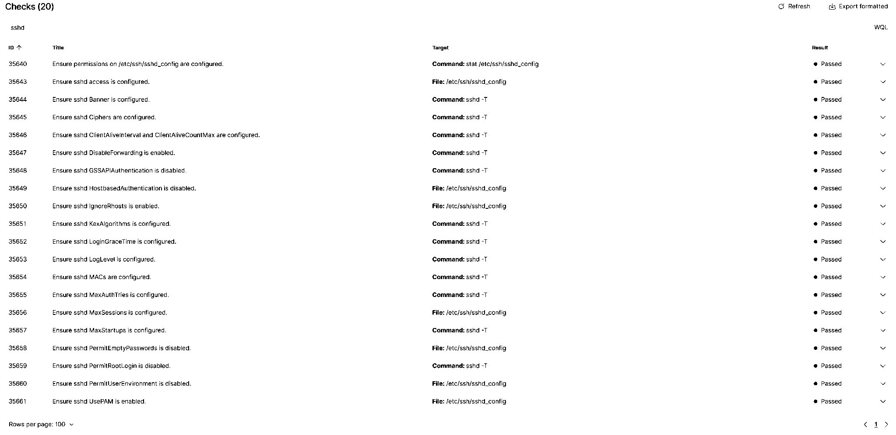
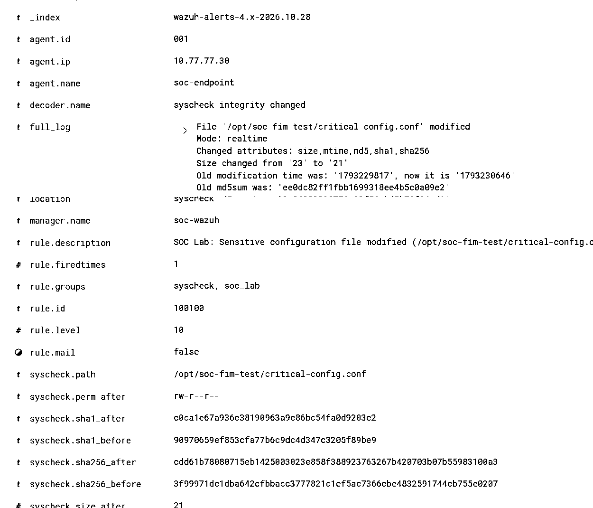
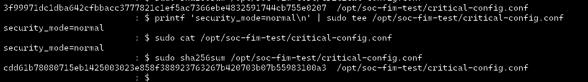

# SOC lab evidence gallery

These screenshots were captured from the **authorized October 2026 home-lab exercises** and added after review. Each image is an excerpt of an existing user-provided capture: **cropped to relevant fields**, with unrelated screen areas removed, and converted to **high-contrast monochrome** to improve readability and avoid including irrelevant interface information. Some images join noncontiguous portions of the **same original screenshot** into a compact vertical layout; no alert fields or result values were invented.

All user identifiers visible in the selected screenshots are **lab-only accounts** (for example `endpointadmin`), and all shown IP addresses are **private `10.77.77.0/24` lab addresses**. No credentials, tokens, session cookies, private keys or signing keys are included.

## Verified evidence

| File | What the image shows | Related documentation |
| --- | --- | --- |
| [SSH CIS: 20/20 passed](ssh-cis-20-of-20.png) | The Wazuh assessment filtered to `sshd`, displaying all 20 checks as Passed | [Hardening](../security-hardening/README.md) |
| [FIM custom positive](fim-custom-positive.png) | `100100`, Level 10, for a modified `critical-config.conf` | [Rule 100100](../detection-rules/README.md) |
| [Sudo custom positive](sudo-custom-positive.png) | `100101`, Level 8, for `/usr/bin/stat /etc/shadow` | [Rule 100101](../detection-rules/README.md) |
| [Sudo negative control](sudo-custom-negative.png) | Ordinary `5402` event for `/usr/bin/stat /etc/hosts`, not `100101` | [Rule 100101](../detection-rules/README.md) |
| [IR-001 recovery alert](ir001-recovery.png) | `100100` recovery modification showing the restored SHA-256 | [IR-001](../incident-reports/IR-001-configuration-tampering.md) |
| [IR-001 terminal hash](ir001-terminal-hash.png) | The harmless test file restored to `security_mode=normal` with verified `sha256sum` | [IR-001](../incident-reports/IR-001-configuration-tampering.md) |

### SSH hardening — 20 passing checks

### Detection engineering — positive and negative examples

### Incident recovery — Wazuh and endpoint verification

## IR-002 — correlated alert evidence to be archived

A second authorized exercise generated rule `100101` (Level 8) followed **8.702 seconds later** by rule `100100` (Level 10) on the same endpoint. A subsequent FIM alert recorded a recovery modification and the known-good SHA-256. See [IR-002 — correlated privileged activity and configuration tampering](../incident-reports/IR-002-correlated-privileged-activity.md).

The IR-002 images were supplied during the exercise but are **not committed to this repository yet**. We still need sanitized copies of the two-alert event view and the recovery alert, plus an incident-specific `sudo` journal excerpt before claiming journal-level actor correlation for IR-002.

## Interpreting the evidence

- The **20/20** result applies **only to the displayed SSH-specific subset** of CIS checks. It is **not the overall CIS compliance score**.
- Rule `100100` does not distinguish attacker tampering from approved restoration: the recovery alert is correctly labeled as **authorized**.
- `sudo stat /etc/shadow` accesses **file metadata**, not password hashes. The custom alert is an investigative signal, **not evidence of credential theft**.
- The FIM *negative-control* test generated two ordinary FIM events, and the custom query returned zero matches, as observed during the exercise. **A screenshot of that particular zero-result query was not captured**, so it is not presented as image evidence.
- These screenshots demonstrate the described individual tests, not exhaustive coverage or production readiness.

## Review checklist before public release

Before changing repository visibility to public, re-review the complete repository history, images and linked documentation for personal details, credentials, identifiers, and any claims that require qualification. The screenshots remain on the **private** repository while this review is pending.
